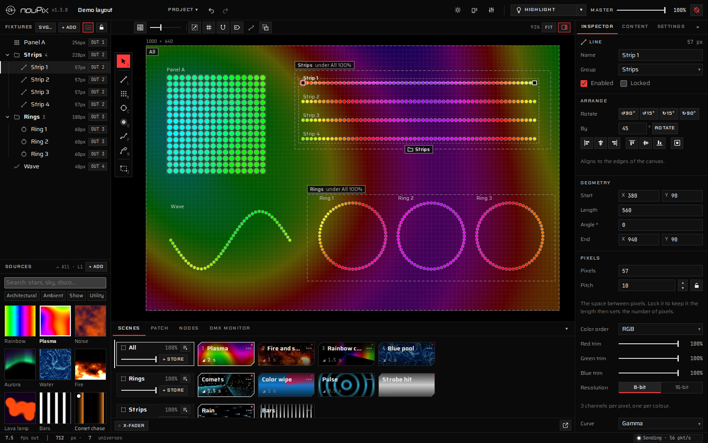
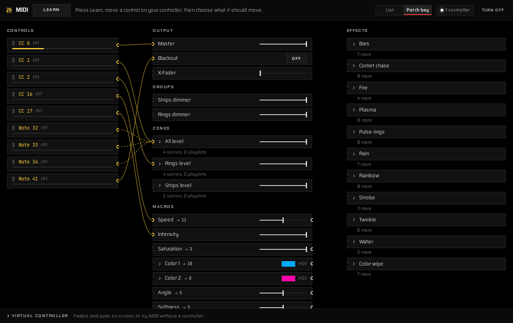
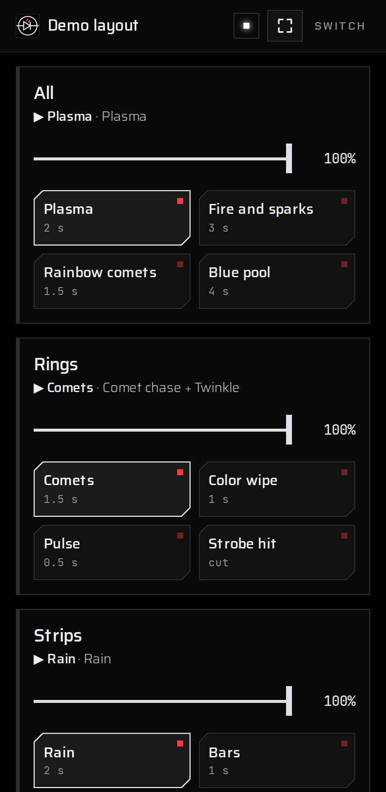
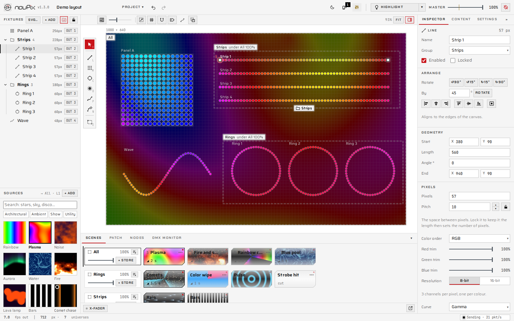

# nouPix 1.3.0


A pixel-mapping tool for LED installations, by nouled studio. Draw or import your LED fixtures, play effects, shaders, images, video or live streams on them, store looks as scenes and playlists, and send it all out over Art-Net or sACN. It was called openLedMapper until 1.0.



## What it does

- **Map your LEDs:** strips, matrices, rings, ovals, curved paths and big single lights (Dot), drawn on the stage or imported from SVG. Lock a strip's pitch and its length sets its pixels, as on a real strip.
- **Play content:** 53 built-in effects, your own ISF shaders, images, video, window capture and NDI or OMT streams, in zones with layers and blend modes.
- **Scenes and playlists:** store looks per zone, fade between them, play them in playlists, mix two zones with the X-Fader.
- **Control it live:** MIDI controllers (with Learn, a patch bay and Flash pads), phones and tablets on the network, and HTTP triggers for show control software.
- **Send it out:** Art-Net or sACN, automatic addressing, node discovery, 8 or 16-bit fixtures with dimming curves, a DMX monitor and test patterns to check the installation on site.

<table>
<tr>
<td width="62%"><br><sub>MIDI: every mapping as a wire in the patch bay</sub></td>
<td width="38%"><br><sub>The Remote page on a phone</sub></td>
</tr>
</table>


<sub>Black by default, so the light on the stage is the brightest thing on screen; white for daylight, in one click.</sub>

## Download

Get the app from the [Releases](https://github.com/nouled-studio/nouPix/releases/latest) page. Nothing else to install.

| Computer | File | Needs |
|---|---|---|
| Windows | `…-windows-setup.exe` | Windows 10 or newer |
| Mac with Apple silicon (M1 or newer) | `…-macos-apple-silicon.dmg` | macOS 12 or newer |
| Mac with an Intel processor | `…-macos-intel.dmg` | macOS 12 or newer |
| Linux (or any computer) | no app: run it from the source ([below](#run-from-the-source-linux-raspberry-pi-any-computer)) | Python 3.8 or newer, and Chrome, Edge or Chromium |

On a Mac, open the `.dmg` and drag nouPix onto Applications. The apps aren't signed yet, so the first time:

- **Windows:** SmartScreen says it protected your PC. Click **More info → Run anyway**.
- **macOS:** click **Done** on the warning, then **System Settings → Privacy & Security → Open Anyway**.

On Windows, allow nouPix through the firewall on private networks when asked, or node discovery won't work.

## Run from the source (Linux, Raspberry Pi, any computer)

You need Python 3.8 or newer and Chrome, Edge or Chromium. Then run:

```
python3 noupix.py
```

On Windows or macOS you can also double-click `start-noupix.bat` or `start-noupix.command`. Keep the terminal open: closing it stops the output. `python3 noupix.py --help` lists the options, for example `--bind-ip 2.0.0.10` to send from a specific network card.

## Learn it

- **[Getting started guide (PDF)](docs/nouPix-getting-started.pdf):** from an empty project to a running show, step by step, with pictures.
- **[User guide](docs/user-guide.md):** everything nouPix does, in detail.
- To see it working first: **Project ▾ → Load demo layout**, or open one of the [examples](examples/).

## For developers

The interface is a web page (`index.html`, `css/`, plain scripts in `js/`, no build step); `noupix.py` (Python, standard library only) serves it and sends Art-Net and sACN; `desktop/` is the Electron app around both (`cd desktop && npm install && npm start`). [CLAUDE.md](CLAUDE.md) describes the architecture and the conventions. Tests: `python3 tests/run_tests.py --quick`. Releases are built by GitHub when a `v<VERSION>` tag is pushed.

## Licence and credits

GNU Affero General Public License 3.0 (AGPL-3.0, see `LICENSE`), © 2026 nouled studio. Anyone may use, change and share nouPix, and sell it too, but whoever passes it on, changed or not, or lets people use a changed copy over a network, must give them its full source under the same licence. Until 17 October 2026 the code was under GPL-3.0; copies taken before then keep that licence. The look and the logo are described in [docs/brand.md](docs/brand.md) and the [brand guide (PDF)](docs/nouPix-brand-guide.pdf). The fonts are Saira, Chakra Petch and JetBrains Mono (SIL Open Font License, `css/OFL.txt`). The ISF renderer is [interactive-shader-format](https://github.com/Vidvox/interactive-shader-format-js) by VIDVOX (ISC licence).
