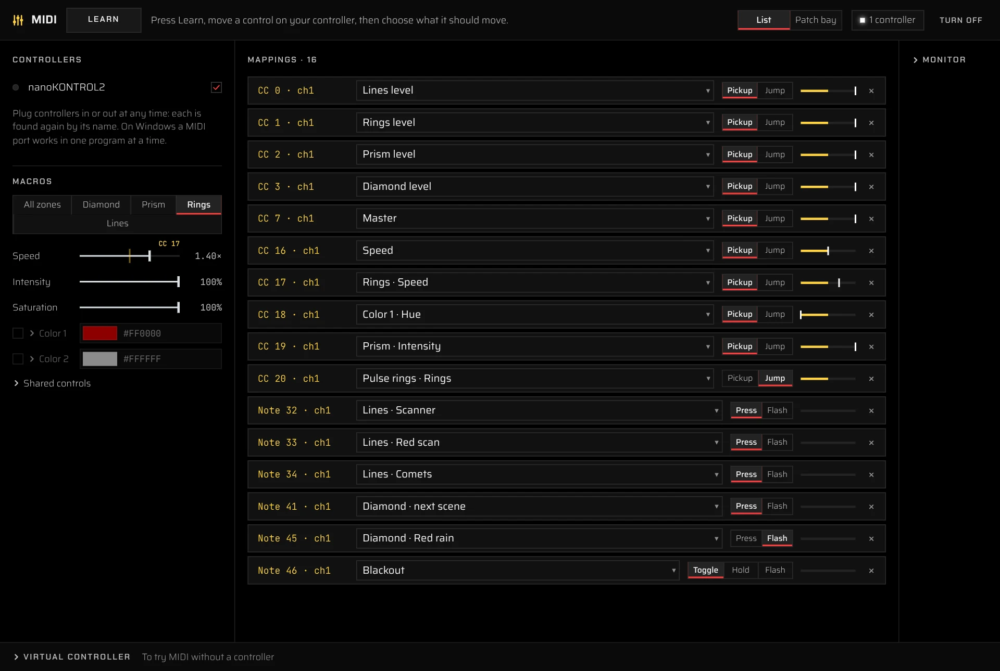
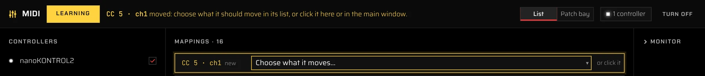
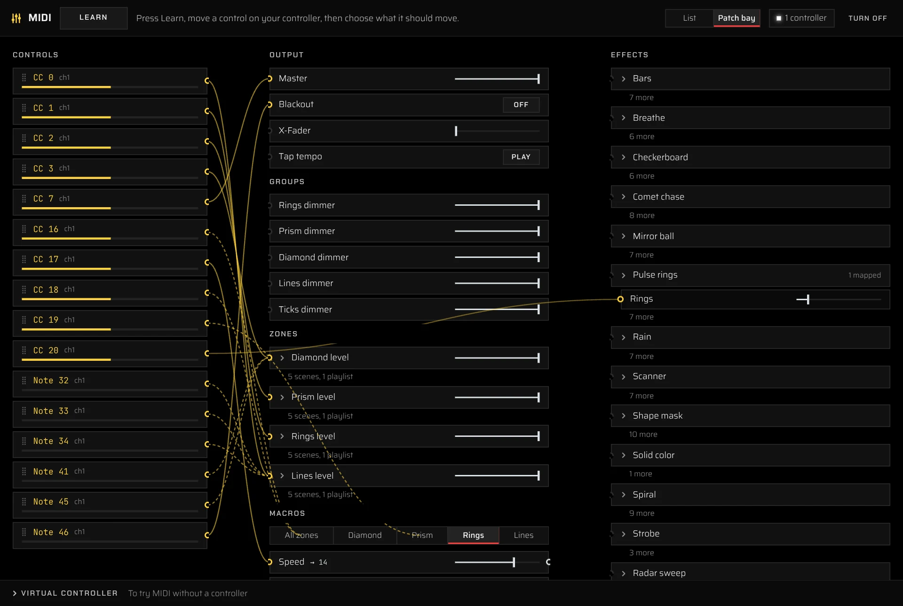

# nouPix: MIDI mapping

Play a project from a MIDI controller: faders on zone levels and macros, pads on scenes. This page covers nouPix 1.6.3.

## 1. Turn it on

1. Click the **MIDI** button in the top bar, then **Turn MIDI on**. The MIDI window opens. The browser may ask whether
   nouPix can use your MIDI devices: allow it. MIDI works in the nouPix app, Chrome and Edge.
2. Your controllers show under **Controllers**. Untick one to ignore it. They can be plugged in or out at any time.
3. No controller at hand? Open the **Virtual controller** at the foot of the window: on-screen faders and pads that act
   as a controller.

## 2. Learn a mapping

1. Click **Learn** (the button turns yellow).
2. Move a control on your controller.
3. Click what it should move: a slider, a scene, a button, in the MIDI window or in the main window. Or choose it from
   the control's list, **Choose what it moves…**
4. Press **Esc** or **Stop learning** when you are done.

It works the other way round too: click the target first, then move the control.

- A control can drive several things: learning it onto something new adds to what it drives. **Alt**-click replaces
  them instead.
- Learning a control onto something another control drives takes it over from that control.
- What a control drives shows a thin yellow line and a tag with its name, such as `CC 7`.

## 3. What a control can drive

| Target | What it does |
|---|---|
| Master, a zone's level, a group's dimmer, the X-Fader | A fader sets it |
| Blackout | On or off |
| A scene | A press plays it, with its fade |
| Next scene | A press plays the zone's next scene |
| A playlist | Play and pause |
| Tap tempo | Each press is a tap |
| A macro | Speed, Intensity, Saturation, the shared controls: for all zones or one zone (see 4) |
| A colour macro's part | Hue, Saturation or Value (or Red, Green, Blue in RGB mode) |
| A control of an effect | That control in every zone that plays the effect |

## 4. Macros, for all zones or one zone

Every zone has its own macros. The tabs over the macros choose which ones you see and map: **All zones**, or a zone.

- **On a zone's tab**, a control learnt on a macro drives that zone's macro only.
- **On All zones**, it sets that macro in every zone.
- If both are mapped, whichever moved last sets the zone. nouPix says so when you make the second mapping.
- A small **≠** on an All zones slider means some zone has its own value now.
- Macros and controls mapped onto an effect act on **stored scenes only**. Content you put in a zone but haven't stored
  as a scene keeps its own values, so you can prepare a look without the controller moving it.
- A colour picked for one layer in the Content tab stays that layer's until its macro moves again. The small link
  next to its name makes it follow the macro again at once.

## 5. How each mapping moves

Each mapping has its options in its row (or on its wire in the patch bay).

| Control | On | Options |
|---|---|---|
| A fader or knob | Anything with a level | **Pickup**: it takes over once the fader reaches the value (a mark shows where). **Jump**: it goes where the fader is at once. |
| A fader or knob | Something on or off | **Follow**: on while the fader is past the middle. **Toggle**, **Flash**. |
| A button or pad | A scene, next scene | **Press**: plays it. **Flash**: plays while held, and what played before comes back when let go. |
| A button or pad | Something on or off | **Toggle**: each press. **Hold**: on while held. **Flash**: on while held, back as it was when let go. |
| A button or pad | A level | **Toggle**: full, then off. **Hold**: full while held. **Flash**: full while held, back where it was. |

Remove a mapping with its **×**. Every change is a step of undo.

## 6. The patch bay

Switch between **List** and **Patch bay** at the top of the MIDI window. Both show the same mappings.

- Three columns: your **controls**; what they can drive (**Output**, **Groups**, **Zones** with their scenes and
  playlists, **Macros** with the same tabs); and the **effects** with their controls.
- **Draw a wire** by dragging from a dot to a row, either way round. A yellow wire is a mapping.
- **Click a wire** for its settings (Pickup or Jump, Toggle, Hold or Flash) and **Remove** (or press **Delete**).
- Point at or click a macro to see, in thin wires, which effect controls follow it. Draw one from a macro's dot to
  an effect's control to make that control follow it.
- Drag a control up or down to put your controls in order (the list follows). **×** forgets a control.

## Good to know

- Mappings are saved with the project. Whether MIDI is on and which controllers are ignored belong to the computer.
- On Windows a MIDI port works in one program at a time: close other MIDI software first.
- **Monitor**, on the right of the MIDI window, shows each message as it arrives: handy to find a control's number.
- MIDI is read by the main window only. Phones and tablets on remote control don't take MIDI.
